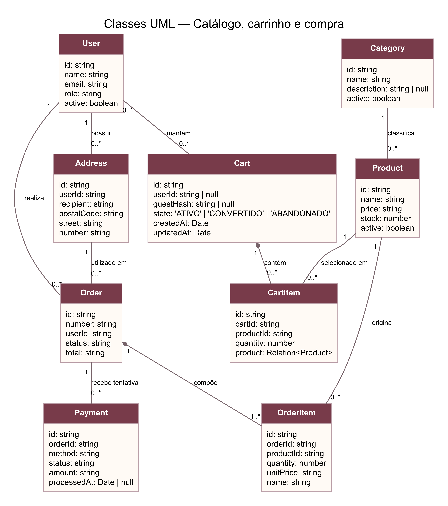
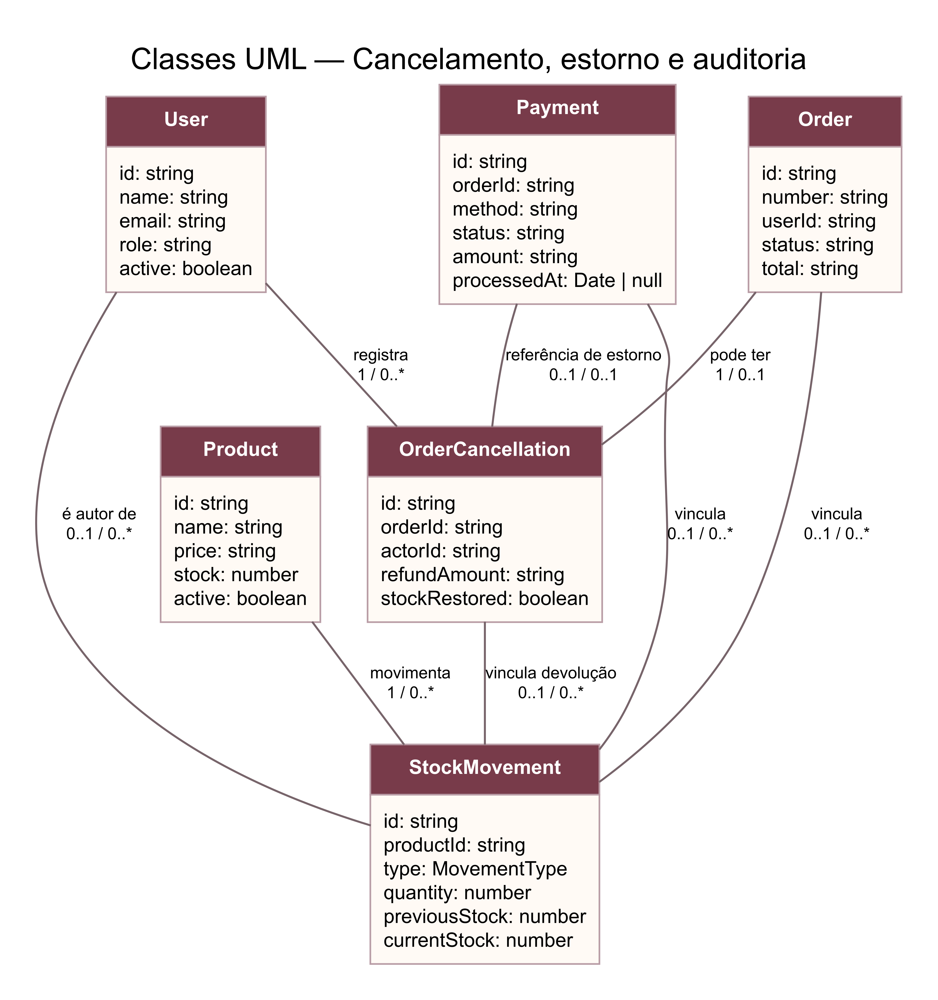
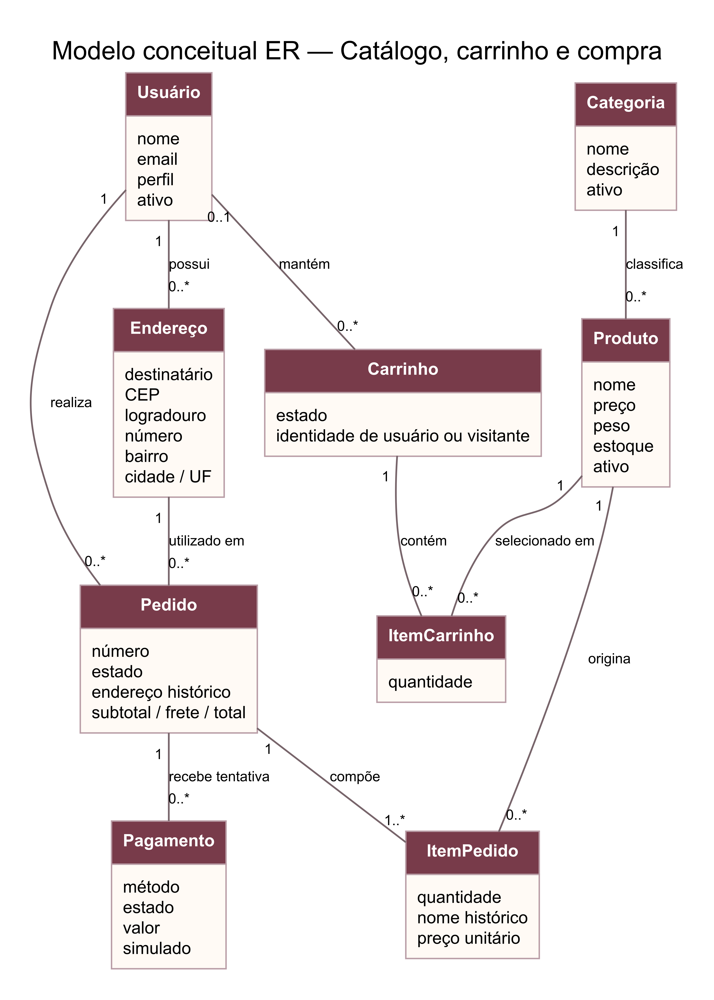
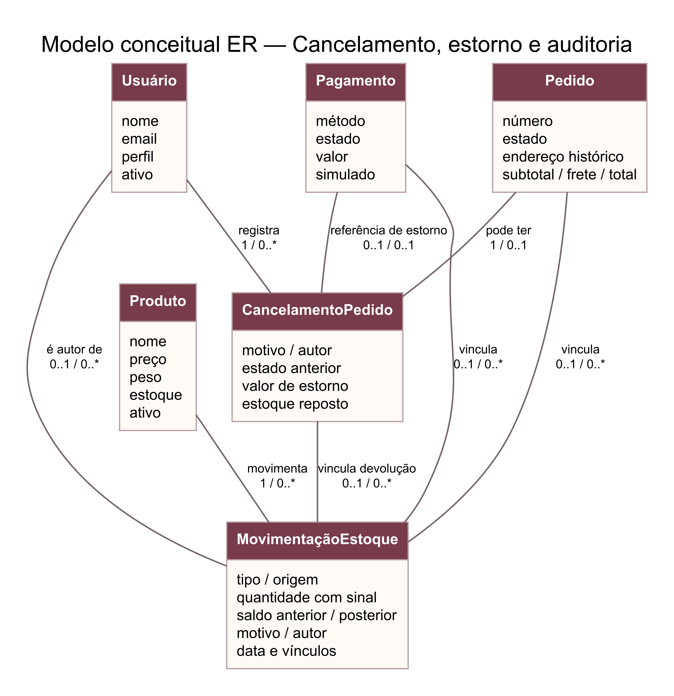
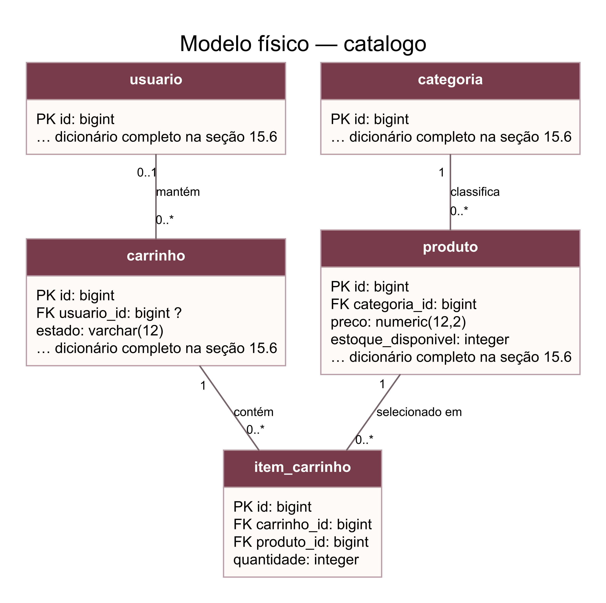
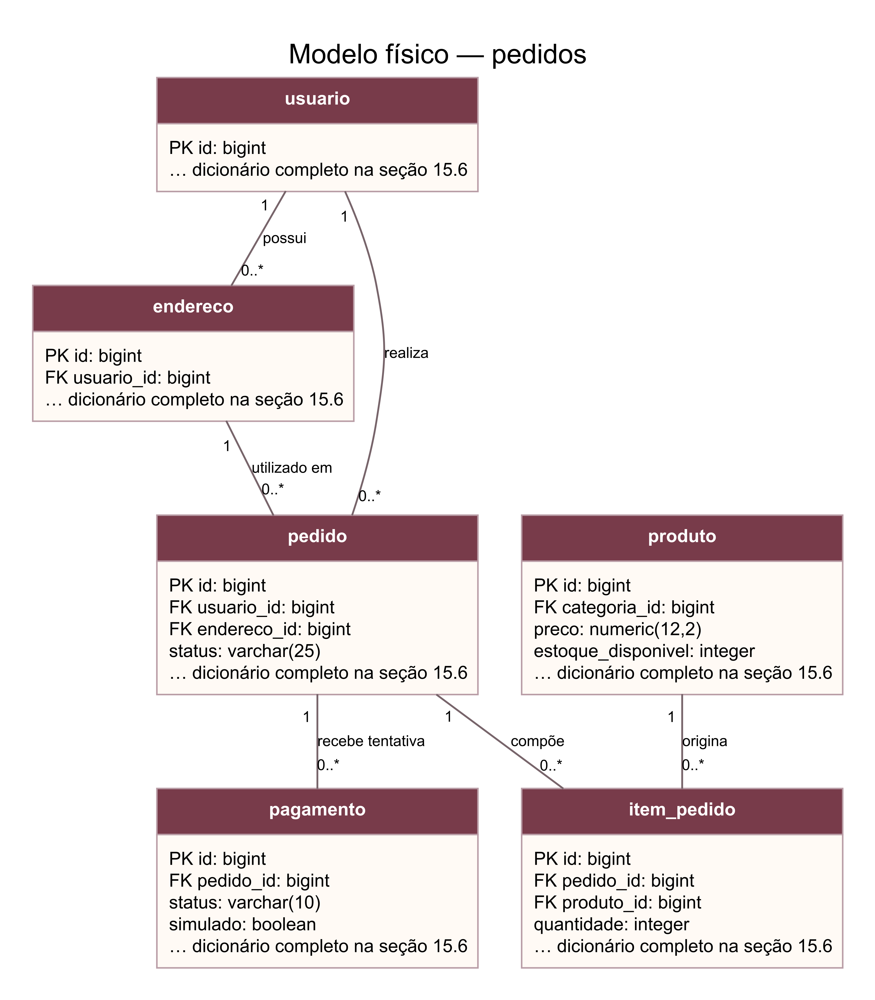
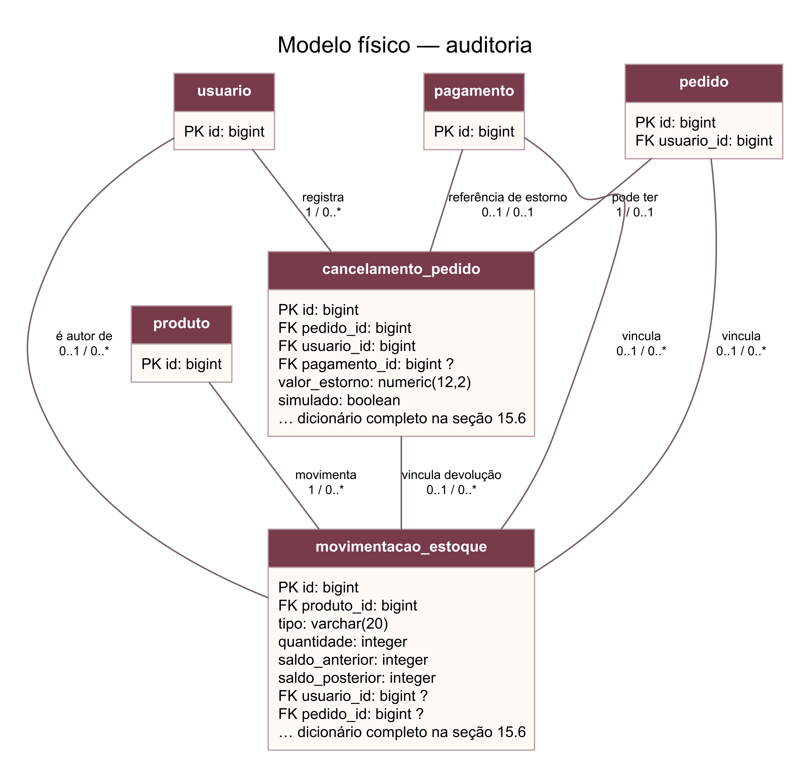
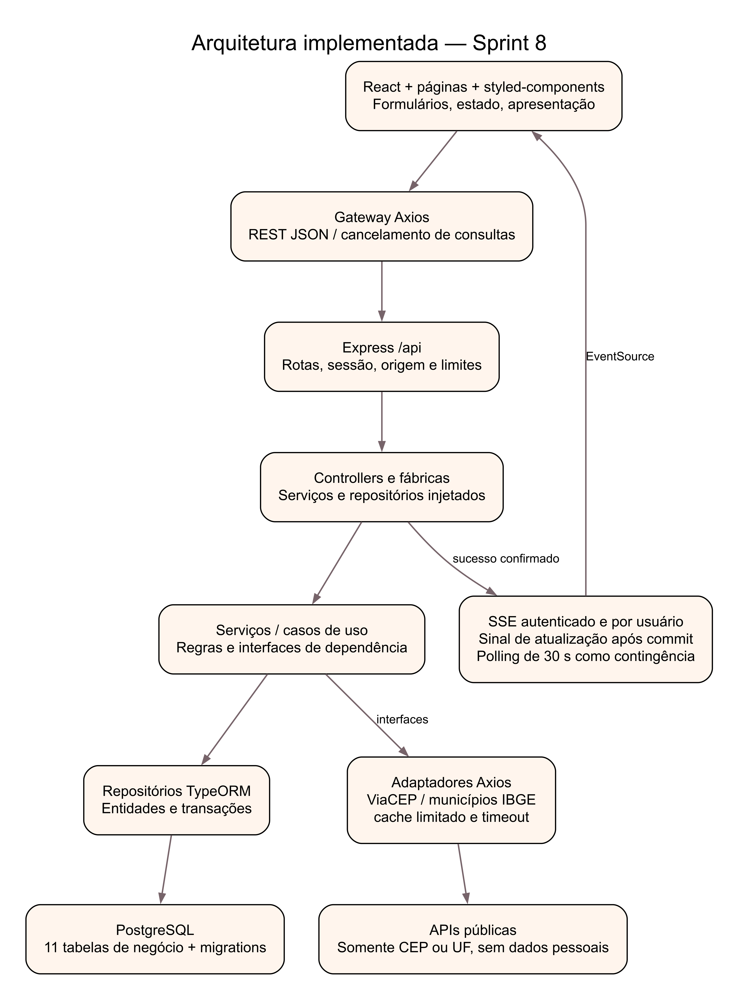
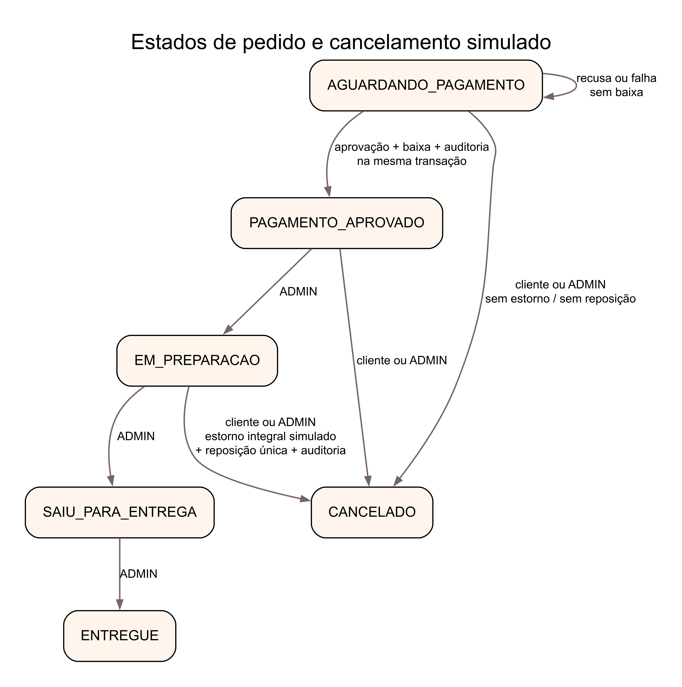

# 15. CONSOLIDAÇÃO DA SPRINT 8 — VERSÃO VIGENTE EM 20/10/2026

Esta consolidação registra a implementação atual e prevalece sobre descrições de planejamento nas seções anteriores quando houver divergência. O histórico, as 15 histórias originais e suas evidências foram preservados; não se trata de reescrever retroativamente o que havia sido entregue. O documento original do PIT I permanece inalterado.

## 15.1 Escopo, decisões e correções de requisitos

A aplicação é um protótipo acadêmico web em React e TypeScript, com páginas separadas, estilos junto dos componentes, API REST em Express e persistência PostgreSQL por TypeORM. Cadastro/login são obrigatórios no checkout, não na vitrine nem no carrinho de visitante. No login, os itens de visitante são incorporados por soma de quantidades ao carrinho autenticado, conforme decisão mantida pelo autor.

Atendimento: todo o Brasil, exclusivamente na simulação. Frete gratuito e nenhuma entrega, cobrança, PIX, boleto ou estorno financeiro real. A consulta de CEP não comprova a existência do número do imóvel, capacidade logística ou entrega real. O administrador é um perfil de Usuário; não há tabela Cliente adicional.

HU01: a página inicial voltou a carregar automaticamente os produtos ativos, com imagem, nome, preço e ações, sem reunir carrinho, pedidos e administração na mesma página. /produtos continua sendo a página de busca e filtros. HU07: o checkout também mostra itens, quantidades, valores e subtotal antes da confirmação.

HU13: o ViaCEP preenche logradouro, bairro, cidade e UF a partir de oito dígitos. Destinatário, número e complemento não são enviados ao provedor. UF tem lista com as 27 unidades; Cidade apresenta municípios da UF por consulta ao IBGE. A seleção é automaticamente ajustada pelo CEP, e mudar a UF limpa a cidade. Cidade/UF divergentes do CEP impedem salvar; o servidor verifica novamente antes da gravação.

CEP inexistente ou inválido gera mensagem e não cria endereço. Campos manuais não são sobrescritos por respostas atrasadas. CEPs gerais podem exigir rua/bairro digitados. Indisponibilidade do ViaCEP preserva os campos e exige nova tentativa antes de cadastrar; endereços anteriormente cadastrados continuam disponíveis no checkout, sem reconsulta externa a cada compra. Indisponibilidade do IBGE mantém como opção a cidade já confirmada pelo CEP, sem inventar uma lista.

HU14: acompanhamento por SSE autenticado, separado por usuário, com atualização após operação transacional bem-sucedida. Os eventos contêm apenas um sinal de invalidação; os dados são buscados novamente nas rotas autorizadas. Há reconexão automática e consulta de contingência a cada 30 segundos com a página visível. Não há rastreamento GPS, garantia de latência em rede externa nem barramento distribuído: o protótipo executa uma instância do servidor.

Cancelamento: cliente dono do pedido e ADMIN podem cancelar AGUARDANDO_PAGAMENTO, PAGAMENTO_APROVADO e EM_PREPARACAO. Após SAIU_PARA_ENTREGA, o cancelamento é bloqueado. Pedido não pago não repõe estoque nem gera estorno. Pedido pago registra estorno integral exclusivamente simulado, repõe estoque uma única vez e registra autor, motivo e movimentações na mesma transação.

## 15.2 Rastreabilidade das 15 histórias e evolução por sprint

HU01 — Vitrine automática / e /produtos; somente catálogo ativo. Evidência de evolução: Sprint 1; páginas S6; ajuste S8.

HU02 — Detalhe /produtos/:id: descrição, preço, peso e imagem. Evidência de evolução: Sprint 1 e S6.

HU03–04 — Busca por nome/descrição e filtros cumulativos de categoria/preço. Evidência de evolução: Sprint 2; evidência local S8.

HU05–06 — Carrinho visitante/conta, inclusão, quantidades, remoção e incorporação no login. Evidência de evolução: Sprint 2.

HU07–08 — Resumo, validações, checkout autenticado e pedido pendente, sem baixa antecipada. Evidência de evolução: Sprint 3; resumo reforçado S8.

HU09–10 — Cadastro com e-mail único, login, hash de senha, sessão e bloqueio por falhas. Evidência de evolução: Sprint 1.

HU11–12 — PIX/cartão/boleto simulados, resultados aprovado/recusado/falha e baixa transacional. Evidência de evolução: Sprint 3.

HU13 — Endereço obrigatório, consulta de CEP, listas UF/municípios e política nacional simulada. Evidência de evolução: Sprint 3; correção S8.

HU14 — Estados definidos, consulta própria, SSE e contingência. Evidência de evolução: Sprint 4; atualização S8.

HU15 — ADMIN: catálogo, categorias, estoque, pedidos e avanços permitidos. Evidência de evolução: Sprint 4.

Extensões — S5: cancelamento/estorno; S6: páginas e styled-components; S7: auditoria ampliada; S8: coerência documental e integrações de endereço. Evidência de evolução: Sprints 5–8.

As histórias de pagamento foram deliberadamente adequadas à simulação acadêmica já aprovada: não se afirma integração bancária nem conformidade LGPD certificada. O protótipo reduz exposição de dados e não recebe dados reais de cartão. HTTPS e controles operacionais de publicação precisam ser configurados no ambiente de hospedagem; localhost não comprova criptografia ponta a ponta em produção.

## 15.3 Arquitetura e responsabilidade dos modelos

REST define o contrato de comunicação HTTP, não a organização interna. Rotas Express encaminham ao controller; a fábrica instancia adaptadores e injeta dependências no serviço. Serviços dependem de interfaces e concentram os casos de uso; implementações TypeORM acessam o PostgreSQL. Adaptações de CEP/municípios usam Axios com domínios fixos, timeout, validação de resposta e cache limitado. Interfaces e DTOs não são tabelas.

UML mostra classes da aplicação, tipos e associações; as entidades TypeORM atuais têm principalmente estado, e as operações de negócio estão nos serviços, não em métodos inventados nas entidades. ER conceitual mostra entidades, atributos de negócio e cardinalidades, sem tipos SQL, FKs ou operações. O modelo físico registra nomes de tabela/coluna, tipos, nulabilidade e restrições do PostgreSQL. As associações UML por identificadores não significam que todos os relacionamentos tenham decorators de navegação no ORM.

## 15.4 Entidades e atributos principais

Usuário (User / usuario) — Identidade autenticada, com perfis CLIENTE/ADMIN; Cliente é um papel, não uma segunda tabela. Atributos de negócio: nome, email, perfil, ativo.

Endereço (Address / endereco) — Endereço de um único usuário; CEP consultado externamente, cidade/UF coerentes; complemento opcional. Atributos de negócio: destinatário, CEP, logradouro, número, bairro, cidade / UF.

Categoria (Category / categoria) — Classifica produtos; categoria e produto precisam estar ativos na vitrine. Atributos de negócio: nome, descrição, ativo.

Produto (Product / produto) — Catálogo e saldo disponível. Alterações de saldo registram movimentações transacionais. Atributos de negócio: nome, preço, peso, estoque, ativo.

Carrinho (Cart / carrinho) — Seleção temporária de usuário ou visitante; no máximo um carrinho ativo por identidade. Atributos de negócio: estado, identidade de usuário ou visitante.

ItemCarrinho (CartItem / item_carrinho) — Associação carrinho/produto, sem duplicidade de produto no mesmo carrinho. Atributos de negócio: quantidade.

Pedido (Order / pedido) — Compra autenticada; conserva endereço de entrega e valores históricos. Atributos de negócio: número, estado, endereço histórico, subtotal / frete / total.

ItemPedido (OrderItem / item_pedido) — Produto, quantidade, nome e preço unitário históricos da compra. Atributos de negócio: quantidade, nome histórico, preço unitário.

Pagamento (Payment / pagamento) — Tentativa exclusivamente simulada. Pode haver várias, no máximo uma aprovada por pedido. Atributos de negócio: método, estado, valor, simulado.

CancelamentoPedido (OrderCancellation / cancelamento_pedido) — Cancelamento único por pedido; guarda autor, motivo e eventual estorno simulado integral. Atributos de negócio: motivo / autor, estado anterior, valor de estorno, estoque reposto.

MovimentaçãoEstoque (StockMovement / movimentacao_estoque) — Registro imutável de abertura, inicialização, reposição, correção, venda ou devolução. Atributos de negócio: tipo / origem, quantidade com sinal, saldo anterior / posterior, motivo / autor, data e vínculos.

Pedido conserva uma fotografia do endereço; ItemPedido conserva nome e preço da compra. Assim, alterações futuras de catálogo ou endereço não mudam o histórico. CancelamentoPedido reúne estorno simulado e não exige outra entidade de estorno: há no máximo um cancelamento e um estorno integral por pedido. MovimentaçãoEstoque é append-only, com compensação por novo registro, não edição da história.

## 15.5 Relacionamentos e cardinalidades validados

Usuário [1] — possui — Endereço [0..*].

Usuário [0..1] — mantém — Carrinho [0..*].

Categoria [1] — classifica — Produto [0..*].

Carrinho [1] — contém — ItemCarrinho [0..*].

Produto [1] — selecionado em — ItemCarrinho [0..*].

Usuário [1] — realiza — Pedido [0..*].

Endereço [1] — utilizado em — Pedido [0..*].

Pedido [1] — compõe — ItemPedido [1..*].

Produto [1] — origina — ItemPedido [0..*].

Pedido [1] — recebe tentativa — Pagamento [0..*].

Pedido [1] — pode ter — CancelamentoPedido [0..1].

Usuário [1] — registra — CancelamentoPedido [0..*].

Pagamento [0..1] — referência de estorno — CancelamentoPedido [0..1].

Produto [1] — movimenta — MovimentaçãoEstoque [0..*].

Usuário [0..1] — é autor de — MovimentaçãoEstoque [0..*].

Pedido [0..1] — vincula — MovimentaçãoEstoque [0..*].

Pagamento [0..1] — vincula — MovimentaçãoEstoque [0..*].

CancelamentoPedido [0..1] — vincula devolução — MovimentaçãoEstoque [0..*].

Leitura da notação: a multiplicidade junto de uma entidade informa quantas instâncias dela podem se relacionar a uma instância do outro lado. Usuário–Carrinho é opcional do lado Usuário porque há visitantes; o histórico pode ter vários carrinhos, mas o índice parcial limita a um ATIVO por usuário ou sessão. A identidade de visitante usa hash de token, não usuário fictício.

Pedido–ItemPedido exige 1..* no negócio, garantido pelo checkout transacional. A FK física só garante que cada item pertença a um pedido; isoladamente ela permite pedido sem itens (0..*). Pedido–Pagamento é 0..*: há tentativas recusadas/falhas, e o índice parcial permite no máximo uma APROVADA. Cancelamento–Pagamento é opcional nos dois lados, com unicidade do pagamento vinculado.

Cada pedido utiliza endereço do próprio comprador: FK composta (endereco_id, usuario_id) → endereco(id, usuario_id). Vínculos opcionais de movimentação tornam-se obrigatórios por tipo nos CHECKs: VENDA exige pedido/pagamento; DEVOLUCAO também exige cancelamento; ABERTURA não tem autor humano. FKs independentes não garantem, sozinhas, coerência cruzada entre todos esses vínculos; os serviços e transações complementam essa validação.

## 15.6 Modelo físico e dicionário de dados vigente

Verificação de leitura no PostgreSQL local em 20/10/2026: 11 tabelas de negócio, 104 colunas e 18 FKs. A tabela técnica de migrations não é uma entidade de negócio. A Sprint 8 não requer alterar tabelas nem reconstruir dados. synchronize, dropSchema e execução automática de migrations permanecem desabilitados; as duas migrations de cancelamento/auditoria são preservadas.

No dicionário abaixo, ? indica coluna anulável; demais colunas são obrigatórias. IDs usam bigint GENERATED ALWAYS AS IDENTITY; valores monetários usam numeric(12,2), e datas com fuso usam timestamptz. Colunas de senha são hashes, nunca senha em texto.

### usuario

id: bigint; nome: varchar(150); email: varchar(254); senha_hash: text; perfil: varchar(10); ativo: boolean; tentativas_falhas: integer; bloqueado_ate: timestamptz ?.

### endereco

id: bigint; usuario_id: bigint; destinatario: varchar(150); cep: varchar(8); logradouro: varchar(200); numero: varchar(20); complemento: varchar(150) ?; bairro: varchar(100); cidade: varchar(100); uf: varchar(2); ativo: boolean.

### categoria

id: bigint; nome: varchar(100); descricao: text ?; ativo: boolean.

### produto

id: bigint; categoria_id: bigint; nome: varchar(150); descricao: text; preco: numeric(12,2); peso_gramas: numeric(10,3); imagem_url: text; ativo: boolean; estoque_disponivel: integer.

### carrinho

id: bigint; usuario_id: bigint ?; token_sessao: varchar(128) ?; criado_em: timestamptz; atualizado_em: timestamptz; estado: varchar(12).

### item_carrinho

id: bigint; carrinho_id: bigint; produto_id: bigint; quantidade: integer.

### pedido

id: bigint; numero: varchar(40); usuario_id: bigint; endereco_id: bigint; criado_em: timestamptz; status: varchar(25); entrega_destinatario: varchar(150); entrega_cep: varchar(8); entrega_logradouro: varchar(200); entrega_numero: varchar(20); entrega_complemento: varchar(150) ?; entrega_bairro: varchar(100); entrega_cidade: varchar(100); entrega_uf: varchar(2); subtotal: numeric(12,2); frete: numeric(12,2); total: numeric(12,2).

### item_pedido

id: bigint; pedido_id: bigint; produto_id: bigint; quantidade: integer; preco_unitario: numeric(12,2); nome_produto_snapshot: varchar(150).

### pagamento

id: bigint; pedido_id: bigint; metodo: varchar(10); status: varchar(10); valor: numeric(12,2); criado_em: timestamptz; processado_em: timestamptz ?; chave_idempotencia: varchar(128); simulado: boolean; motivo_resultado: text ?.

### cancelamento_pedido

id: bigint; pedido_id: bigint; usuario_id: bigint; perfil_usuario: varchar(10); status_anterior: varchar(25); motivo: varchar(500); chave_idempotencia: varchar(128); criado_em: timestamptz; pagamento_id: bigint ?; status_estorno: varchar(20); valor_estorno: numeric(12,2); estornado_em: timestamptz ?; estoque_reposto: boolean; simulado: boolean.

### movimentacao_estoque

id: bigint; produto_id: bigint; nome_produto: varchar(150); tipo: varchar(20); quantidade: integer; saldo_anterior: integer; saldo_posterior: integer; motivo: varchar(500); usuario_id: bigint ?; perfil_usuario: varchar(10); origem: varchar(20); pedido_id: bigint ?; pagamento_id: bigint ?; cancelamento_id: bigint ?; criado_em: timestamptz.

Restrições relevantes: e-mail único; quantidades positivas; saldo não negativo; totais consistentes; produto único por carrinho/pedido; no máximo um carrinho ativo por identidade; chave de idempotência única em pagamento e cancelamento; cancelamento e pagamento de estorno únicos; índices de venda/devolução impedem repetição por produto e operação. Triggers bloqueiam UPDATE, DELETE e TRUNCATE de movimentação de estoque para usuários comuns da aplicação; isso não equivale a inviolabilidade contra superusuário do banco.

### 15.6.1 Figuras atualizadas

As figuras seguintes complementam e substituem, para a versão vigente, os diagramas antigos com nove entidades. As duas vistas UML e as duas vistas ER devem ser lidas em conjunto; classes/entidades repetidas identificam o mesmo objeto de negócio. Os três recortes físicos cobrem as onze tabelas, com tabelas de referência abreviadas somente no recorte de auditoria.

Figura 5 — Classes UML: catálogo, carrinho e compra.

Figura 6 — Classes UML: cancelamento, estorno e auditoria.

Figura 7 — ER conceitual: catálogo, carrinho e compra.

Figura 8 — ER conceitual: cancelamento e auditoria.

Figura 9 — Modelo físico: catálogo e carrinho.

Figura 10 — Modelo físico: pedidos e pagamentos.

Figura 11 — Modelo físico: cancelamento e movimentações.

Figura 12 — Arquitetura implementada e integrações.

Figura 13 — Estados, pagamento e cancelamento simulados.

## 15.7 Testes, desempenho e evidências

Resultado final: 148 testes automatizados aprovados (133 anteriores e 15 da Sprint 8), sem falhas, ignorados ou pendências; verificação de tipos e compilação aprovadas. Os novos cenários cobrem CEP, timeout/erro de provedor, municípios por UF, autorização, seleção coerente, preservação de edição, SSE por usuário e fechamento de conexão. Testes automatizados não substituem os pareceres externos exigidos pela disciplina.

Medição local de API, 20 amostras sequenciais por consulta, quatro produtos no catálogo, Node 20.20.0 e PostgreSQL 18.1 em Windows: vitrine máximo 222,86 ms (p95 28,23 ms); busca máximo 91,51 ms (p95 18,33 ms). Leitura completa do JSON incluída; sem carga concorrente, hospedagem externa ou cache de navegador. Não é medição de renderização nem promessa de SLA.

Conferência de interface com navegador integrado: cinco recargas observaram quatro cartões na página inicial em 324, 230, 212, 208 e 234 ms; cinco buscas observaram um resultado em 377, 350, 360, 356 e 374 ms. São tempos de parede entre ação de automação e observação do DOM, incluindo o custo da ferramenta; não equivalem a LCP, pintura das imagens ou medição em dispositivos/redes de terceiros. Os limites de 3 s e 2 s foram atendidos nessa amostra local, não certificados em produção.

A consulta pública do CEP de exemplo 01001000 retornou Praça da Sé, Sé, São Paulo/SP. A validação visual não cria endereço, pedido, pagamento, cancelamento ou movimentação real. Não foram inventadas evidências de uso por colegas.

## 15.8 Manual de uso resumido

Visitante: abra / para a vitrine automática; use /produtos para buscar e filtrar; abra o detalhe e adicione ao carrinho. Ajuste quantidades em /carrinho. Para finalizar, entre ou cadastre-se; os itens de visitante são incorporados ao carrinho salvo por soma, respeitando limites e disponibilidade.

Checkout: confira itens/valores e selecione um endereço existente ou informe CEP. Aguarde o preenchimento automático, confira UF e cidade nas listas e complete destinatário, número e, se necessário, rua/bairro. Cidade/UF devem corresponder ao CEP; se mudar o CEP, aguarde a nova consulta. Salve o endereço, selecione método simulado, confirme o pedido e escolha o resultado do pagamento. Nenhum dado bancário deve ser informado.

Pedidos: /pedidos lista somente os pedidos da conta. Abra um pedido para acompanhar estado, valores e pagamento; a página atualiza por eventos e também oferece atualização manual. Até Em preparação, é possível cancelar informando motivo; quando pago, o estorno e a reposição são simulados e registrados uma vez.

ADMIN: /administracao permite gerenciar catálogo, categorias, saldo e estados. /administracao/estoque mostra histórico e filtros. Ajuste de saldo exige motivo; correções são novas movimentações, não alteração do histórico. Avance pedidos somente para o próximo estado permitido. Não use dados pessoais reais em apresentações públicas.

## 15.9 Pendências formais para entrega acadêmica

Ainda dependem do autor: obter e preencher o template oficial atualizado no AVA; colher cinco avaliações reais de colegas, com nomes, datas, cenários, problemas e correções, e entregar os cinco pareceres em PDF; produzir o vídeo narrado pelo aluno; revisar a apresentação final e enviar os materiais pelo canal oficial. O código, os testes e este texto não demonstram que esses atos foram realizados.

O roteiro oficial fornecido contém divergência de duração: a página física 29 solicita pelo menos cinco minutos, enquanto as páginas 27 e 30 indicam até cinco minutos. Sugere-se vídeo de aproximadamente cinco minutos e confirmação expressa com o tutor antes da entrega; não se apresenta uma interpretação como regra oficial resolvida.

A aplicação foi verificada localmente. Disponibilidade pública de execução/hospedagem e HTTPS não foram comprovados nesta sprint. O repositório público contém código, não a senha do banco ou sessões. Não há commit ou push automático autorizado para esta Sprint 8; os arquivos permanecem como alterações locais até solicitação específica.

## 15.10 Referências e reprodutibilidade

- Roteiro oficial: PITSInformacaoII.pdf fornecido pelo autor, páginas físicas 25–32.
- [ViaCEP — documentação da consulta de CEP.](https://viacep.com.br/)
- [IBGE — API de localidades e municípios por UF.](https://servicodados.ibge.gov.br/api/docs/localidades)
- [MDN — eventos enviados pelo servidor (SSE).](https://developer.mozilla.org/en-US/docs/Web/API/Server-sent_events/Using_server-sent_events)
- [Código — repositório público da CupCake Store.](https://github.com/MullerEsposito/cupcake-store)

Fontes dos diagramas em docs/diagrams/sprint-8/*.dot, com SVG para ampliação e PNG para incorporação. Dicionário e restrições conferidos por scripts/check-sprint8.mjs, sem escrever dados de negócio. Para reproduzir as figuras, use Graphviz: dot -Tsvg arquivo.dot -o arquivo.svg; dot -Tpng arquivo.dot -o arquivo.png. O layout técnico foi separado por assunto para manter legibilidade.
